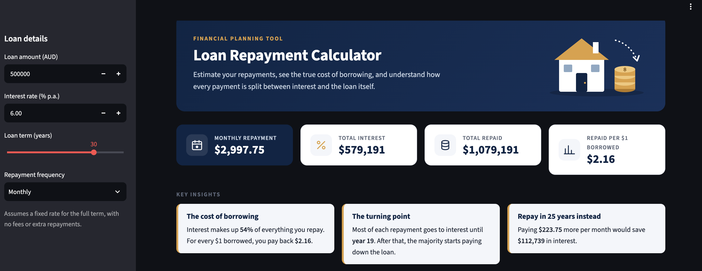
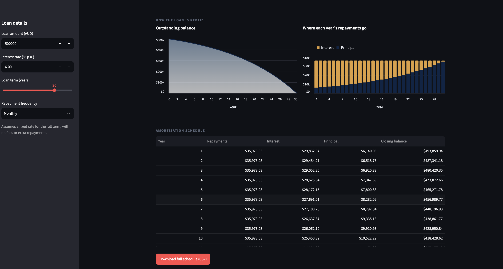

# Loan Repayment Calculator

A simple tool to work out loan repayments and see where the money actually goes.
I built it because most loan calculators just give you one number, and I wanted to
see how much of each repayment is interest and how that changes over the life of the loan.

## What it does
- Calculates the repayment for any loan amount, rate, term and frequency
- Shows total interest and total repaid
- Charts the balance over time and the interest vs principal split each year
- Full amortisation schedule, downloadable as CSV

## How it works
The repayment uses the standard amortisation formula:

EMI = P × r × (1 + r)^n / ((1 + r)^n − 1)

where P is the loan amount, r is the rate per period and n is the number of repayments.

The maths lives in `calculator.py` and the interface in `app.py`, so the calculations
can be tested on their own.

## Testing
| Scenario | Repayment | Total interest |
|---|---|---|
| $500k, 6%, 30 yrs, monthly | $2,997.75 | $579,190.95 |
| $500k, 6%, 25 yrs, monthly | $3,221.51 | $466,452.10 |
| $500k, 6%, 30 yrs, fortnightly | $1,382.92 | $578,673.70 |
| $30k car loan, 8.5%, 5 yrs | $615.50 | $6,929.76 |
| $20k, 0%, 2 yrs | $833.33 | $0.00 |

Every schedule ends at a balance of exactly $0.

## What I found
On a $500k loan at 6% over 30 years, you end up paying back more than double what you
borrowed, and over half of that is interest. For the first 18 years, most of each
repayment goes to interest rather than the loan itself.

Cutting the term to 25 years only adds about $224 a month, but saves over $112,000
in interest. Switching to fortnightly repayments on its own barely changes anything,
since the rate is just split into smaller periods.

## Run it
    pip install -r requirements.txt
    python3 -m streamlit run app.py
